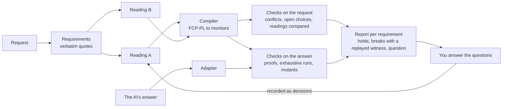

# FCP: the Formal Context Protocol

When an AI system writes a chip design, a reply, an agent or a piece of
code, it can also write the checks, and "all checks pass" then proves very
little. FCP checks the answer against the **request**. It proves what holds,
replays every failure, and turns what no machine can settle into a short
list of concrete questions about the request. A person reviews those
questions, not every line of the answer.

OpenFCP is the research prototype. It handles Verilog designs, text
responses, tool-using agents and Python code.



## The idea

Every verification claim rests on two questions.

- **Conformance:** does the answer satisfy the formal reading of the
  request? A machine decides this, by proof or by exhaustive runs over a
  declared scope, and every counterexample is replayed.
- **Fidelity:** does the formal reading mean what the request says? No
  machine can decide this. FCP reduces it to small questions, each with a
  witness: a run on which two independent readings disagree, a minimal set
  of requirements that cannot hold together, an output the request leaves
  open, or a change to the answer that no requirement notices.

## How it works

1. **Requirements.** An agent splits the request into atomic requirements,
   each tied to a verbatim quote that FCP re-checks on every load.
2. **Readings.** Two agents, isolated from the answer and from each other,
   write each requirement in FCP-PL, a past-time temporal language with
   exact integer arithmetic.
3. **Compilation.** A deterministic compiler turns each reading into
   Verilog monitors.
4. **Analyses.** Proof with a bounded cross-check and replay, vacuity,
   consistency, determinacy, comparison of the readings, mutation coverage,
   and for code exhaustive runs within a scope.
5. **Verdicts.** Each requirement gets a level that says what was
   established. Everything else goes to a review queue with its witness.

FCP adds no new solver. It uses yosys, SymbiYosys, z3 and Icarus, and its
contribution is the protocol around them: which question to ask, in which
form, and what an answer may mean.

## Results

**Chips** (4 designs, 16 agent runs, 28 injected defects;
[docs/FCP_paper.md](docs/FCP_paper.md))

| | AI writes the assertions | FCP |
|---|---|---|
| Violated requirements certified as holding | 56 / 244 | 0 / 244 |
| Faulty formalizations that certify a buggy design | 71 / 161 | 0 / 161 |
| Injected RTL defects detected | 28 / 28 | 28 / 28 |

All 45 disagreements between two AI readers were real errors, and FCP found
three defects nobody planted.

**Prompts** ([docs/FCP_fsm.md](docs/FCP_fsm.md)). Before any model wrote a
response, FCP proved that the demo email prompt cannot be satisfied as
written and named the six instructions that clash. An LLM judge passed all
three responses on all 33 checks.

**Agents** ([docs/FCP_agent.md](docs/FCP_agent.md)). The scaffold is the
chip and the model's tool call is a free input, so a proof holds for every
model output. On a returns-desk agent the guarded scaffold enforces 8 of 9
rules for any model, and 6 of 8 planted scaffold bugs are invisible while
the model behaves.

**Code** ([docs/FCP_code.md](docs/FCP_code.md)). Ten tasks, each a short
prompt with one planted conflict, implemented by Haiku, Sonnet and Opus.

- FCP finds the conflict before any code is written, with the call that
  shows it.
- Every model's code passes its own tests and breaks a rule of the prompt.
  Accepting those tests certifies every violation.
- On the gift card task both readers and all three models took the same
  side of an ambiguity, and FCP certified three violations. A third reader
  per answer to each flagged phrase removes them: on all ten tasks no false
  certificate remains, and `fcp review` keeps 84 of the 87 true ones.
- Where the code translates to z3, FCP proves a requirement for every
  input, and for objects every sequence of calls. Over seven tasks every
  failure found on the scope also fails the proof, and the proof found
  seven failures the scope did not reach.
- Each z3 proof is decided again by cvc5.

**Requests written by others** ([docs/FCP_code.md](docs/FCP_code.md) §13).
On 80 requests from the HumanEvalComm benchmark, `fcp review` reviewed 72
before any code was written and raised a question backed by an engine
result on 34 of the 53 reviewed rewrites. The same model, told to ask
before it writes code, asks on 56 of 60, at a far lower cost. On short
requests a review adds a checked result under the question, not recall.

**Lean** ([docs/FCP_lean.md](docs/FCP_lean.md)). A reference semantics of
FCP-PL in Lean 4 agrees with the compiled monitors of all 46 readings on
1,747,852 compared cycles, after the comparison exposed three defects in
the monitor compiler. 84 theorems cover the registers, causality and
Propositions 1 to 4 of the paper.

## Setup

```bash
# OSS CAD Suite (yosys, sby, z3, iverilog, verilator) into .tools/oss-cad-suite
curl -L -o oss.tgz https://github.com/YosysHQ/oss-cad-suite-build/releases/download/2026-11-06/oss-cad-suite-linux-x64-20261106.tgz
mkdir -p .tools && tar xzf oss.tgz -C .tools
python3 -m venv .venv && .venv/bin/pip install z3-solver pyyaml jsonschema pytest

# Optional: second solver on every proof
.venv/bin/pip install cvc5

# Optional: Lean 4.35.0 into .tools/lean, for the reference and the theorems
curl -L -o lean.tar.zst https://github.com/leanprover/lean4/releases/download/v4.35.0/lean-4.35.0-linux.tar.zst
mkdir -p .tools/lean && tar --zstd -xf lean.tar.zst -C .tools/lean --strip-components=1
(cd lean && PATH=$PWD/../.tools/lean/bin:$PATH lake build)
```

## Quick start

```bash
bin/fcp lint    corpus/fifo                   # schema, provenance, typing
bin/fcp explain corpus/fifo --set gold        # every formal item in English
bin/fcp check   corpus/fifo --set gold --set literal --rtl ref --rtl B4
bin/fcp check   corpus/code_mask --set gold   # a code prompt, before any code
bin/fcp code    corpus/code_mask corpus/code_mask/agents/coder_opus/mask_card.py
.venv/bin/python -m pytest tests/
```

`fcp review` runs the whole protocol on one answer with no person in the
loop; with `--signature` in place of `--code` it reviews a request before
any code exists. Its agents run in a sandbox without access to your home
directory. Inside Claude Code, the skill `/fcp-review` reviews the answer
the session just wrote ([docs/FCP_code.md](docs/FCP_code.md) §9, §10).

## Reproducing the studies

All scripts run with `.venv/bin/python`. Results land in
`experiments/results/`.

| Study | Script |
|---|---|
| Chips | `experiments/run_study.py`, then `experiments/summarize.py` |
| Prompt | `experiments/prompt_demo.py` |
| Agent | `experiments/agent_demo.py` |
| Code tasks | `experiments/code_demo.py [task]`, e.g. `code_mask`, `code_limit`, `code_card` |
| Code with effects | `experiments/effects_demo.py [code_save \| code_order]` |
| Proofs beyond the scope | `experiments/prove_demo.py <task>` (run alone) |
| Third reader on all ten tasks | `experiments/variant_demo.py` (`plan`, `agents`, `compare`, `under`, `summary`) |
| HumanEvalComm | `experiments/comm_fetch.py`, then `experiments/comm_demo.py` |
| Lean reference | `experiments/lean_oracle.py` |

Every agent prompt and output is recorded under `corpus/*/agents/`, so the
studies replay without the models. Every proof task is content-addressed
and can be re-run on its own with `sby -f task.sby`. In the recorded
prompts and transcripts, local directory paths are replaced by the
placeholders `/repo`, `/work` and `/cache`.

## Repository layout

| Path | Contents |
|---|---|
| [docs/](docs) | The IR and FCP-PL ([IR_spec.md](docs/IR_spec.md)) and one document per study |
| [fcp/](fcp) | The engine: language and monitor compiler, analyses, adapters, proofs, `fcp review` |
| [lean/](lean) | FCP-PL in Lean 4: reference semantics, oracle, theorems |
| [corpus/](corpus) | Four chips, one prompt, one agent, ten code tasks, each with its spec, readings and answers |
| [experiments/](experiments) | Study scripts and results |
| [tests/](tests) | Engine and adapter tests |

## Limitations

- **Scale.** The designs are small, and every task was written with a
  planted defect, apart from the HumanEvalComm requests.
- **Correlated readers.** Two readers can agree and both be wrong.
  Agreement is evidence about the readings, not about intent.
- **Text.** Verdicts on text are exact relative to their labels, and the
  labels are the trust boundary.
- **Code.** Evidence is exhaustive within a declared scope. It is a proof
  for all inputs only where the code translates to z3 terms, and a bounded
  result is reported as bounded.
- **Lean.** The theorems are about the monitor registers as transcribed
  into Lean; the link to the Verilog text is a comparison on sampled traces.
- **Review cost.** Zero false assurance comes with a queue of questions,
  8 to 27 per reading on the chip designs.

## Citation

```bibtex
@misc{fcp2026,
  title  = {{FCP}: Formal Context Protocol for Verifying {LLM}-Generated Artifacts},
  author = {Shashank},
  year   = {2026},
  note   = {Research prototype, https://github.com/shankch/FCP_oss}
}
```

## License

Apache License 2.0 (see [LICENSE](LICENSE)).
